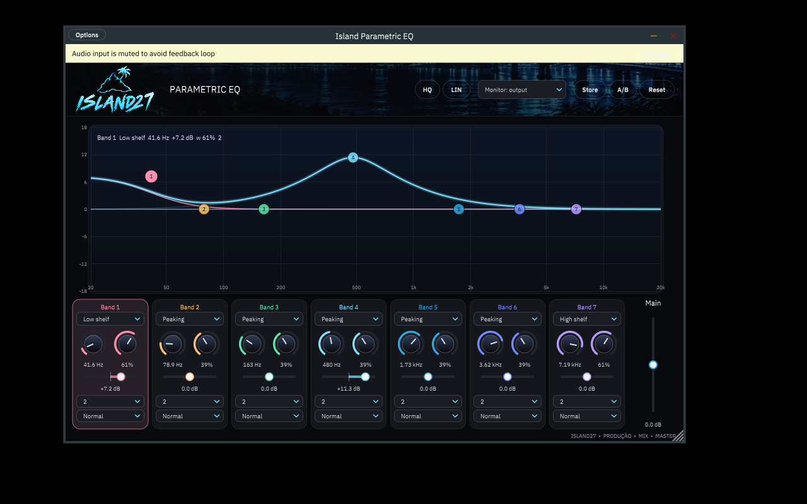

# Island Parametric EQ

Equalizador paramétrico de 7 bandas da **ISLAND27**. É uma recriação independente,
em VST3/AU/Standalone, do comportamento do *Fruity Parametric EQ 2* do FL Studio,
feita por engenharia reversa do binário original. A análise completa está em
[docs/ENGENHARIA_REVERSA.md](docs/ENGENHARIA_REVERSA.md).



## Recursos

- 7 bandas com 8 tipos: Disabled, Low pass, Band pass, High pass, Band stop,
  Low shelf, Peaking e High shelf.
- Ordem por banda: Steep 4/6/8, 2 e Gentle 4/6/8 (−12 a −48 dB/oitava).
- Ganho de ±18 dB por banda, nível principal de ±18 dB e frequências de 20 Hz a 20 kHz.
- Mesmos mapeamentos e padrões do original. Os parâmetros seguem a mesma ordem de
  automação: níveis, frequências, larguras, tipos, ordens e nível principal.
- **HQ:** oversampling 2×.
- **LIN:** modo de fase linear (FIR).
- Analisador de espectro (entrada ou saída).
- Mute/solo por banda.
- Comparação A/B ("Store" e "A/B").
- Tokens arrastáveis na curva:
  - Arrastar muda a frequência e o ganho.
  - A roda do mouse muda a largura.
  - Duplo clique reseta a banda.
  - Botão direito abre o menu de tipo, ordem e mute/solo.
- Visual com a identidade do site island27: cores #08090C, #7FE3FF e #2AA9E0,
  fontes Space Grotesk e IBM Plex Sans, logo e banner.

## Testar no Windows

O arquivo [`dist/IslandParametricEQ-windows-x64.zip`](dist/IslandParametricEQ-windows-x64.zip) traz:

- `Island Parametric EQ.exe`: aplicativo standalone. Basta abrir; não precisa instalar nada.
  Em **Options → Audio/MIDI Settings**, escolha a entrada e a saída de áudio.
- `Island Parametric EQ.vst3`: copie para `C:\Program Files\Common Files\VST3\`
  e faça um novo scan de plugins no FL Studio (ou em outra DAW).

> Essa build foi compilada de forma cruzada (MinGW-w64) e testada no Wine. Ela abre
> e desenha a interface completa, mas ainda não foi testada num Windows real com
> áudio. O workflow `build` do GitHub Actions gera também uma build nativa com MSVC.

## Compilar

Requisitos: CMake 3.22+ e um compilador C++17. O JUCE é baixado automaticamente
(7.0.12) se não houver um instalado.

```bash
cmake -S . -B build -DCMAKE_BUILD_TYPE=Release
cmake --build build --config Release
ctest --test-dir build        # testes do núcleo DSP
```

Os artefatos saem em `build/IslandParametricEQ_artefacts/Release/` (VST3,
Standalone e AU no macOS).

- **Windows a partir do Linux (Ubuntu 24.04):** `scripts/build-windows-mingw.sh`.
- **Só o núcleo DSP, sem JUCE:** `-DISLANDEQ_BUILD_PLUGIN=OFF`.

## Estrutura

| Caminho | Conteúdo |
|---|---|
| `src/core/IslandEQ.h` | Núcleo DSP sem dependências: mapeamentos, projeto dos biquads, motor em tempo real e FIR de fase linear |
| `src/plugin/` | Plugin JUCE: processador, editor e tema visual island27 |
| `tests/core_tests.cpp` | Testes: mapeamentos, ganhos, inclinações, motor × curva teórica, estabilidade e FIR |
| `resources/` | Logo, banner, ícone e fontes (OFL) |
| `docs/ENGENHARIA_REVERSA.md` | Evidências da engenharia reversa |

## Aviso

Projeto independente, sem afiliação com a Image-Line. "FL Studio" e "Fruity" são
marcas da Image-Line. Nenhum código, arte ou recurso do plugin original foi
incluído. Só o comportamento foi reproduzido. As fontes Space Grotesk e IBM Plex
Sans são distribuídas sob a SIL Open Font License.
